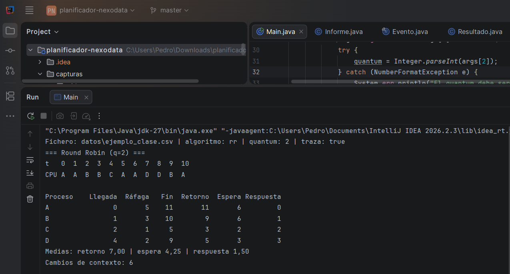
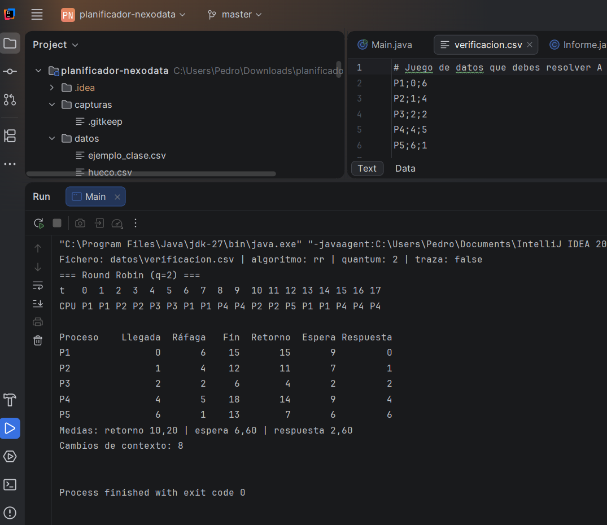
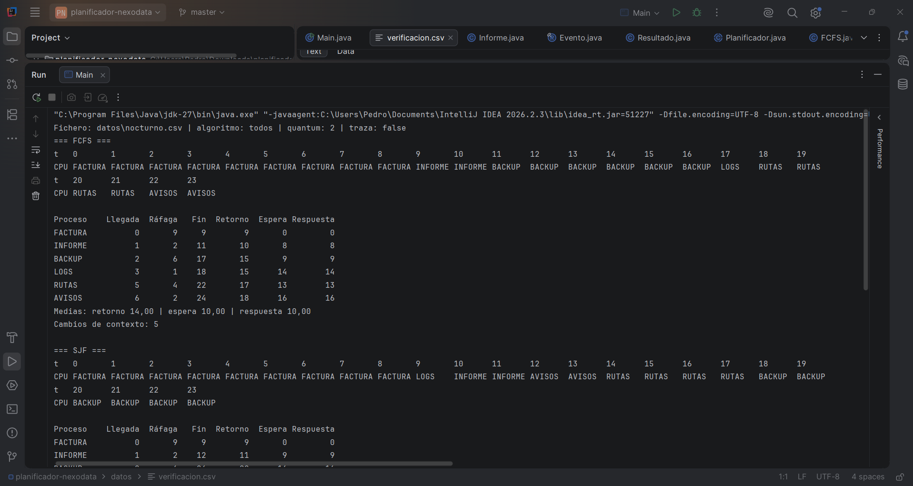

# Simulador de planificación de CPU para NexoData

**Módulo:** 0490 Programación de Servicios y Procesos · 2.º DAM · Tema 2
**Autor:** *(tu nombre)*

---

## 1. Qué hace el proyecto

Simulador de consola en Java que reproduce cómo un planificador de corto plazo reparte una CPU entre varios procesos. Lee de un fichero CSV una lista de procesos (`nombre;llegada;ráfaga`) y los simula con **FCFS**, **SJF sin desalojo** o **Round Robin** (con el quantum indicado), o con los tres seguidos (`todos`).
Para cada algoritmo muestra el diagrama de Gantt, una tabla con fin, retorno, espera y respuesta de cada proceso y sus medias, el número de cambios de contexto y, con `--traza`, cada transición de estado con su motivo.
Sirve para comparar políticas de planificación con los trabajos nocturnos de NexoData (empresa ficticia) y recomendarles una con datos.

---

## 2. Cómo compilarlo y ejecutarlo

Requisitos: JDK 17 o superior.

### Desde IntelliJ IDEA

1. `File → Open` y elige la carpeta `planificador-nexodata`.
2. Si `src` no sale en azul: clic derecho → `Mark Directory as → Sources Root`.
3. `Run → Edit Configurations…`, en la configuración de `Main`:
   - **Program arguments:** `datos/ejemplo_clase.csv rr 2 --traza`
   - **Working directory:** la carpeta del proyecto (`planificador-nexodata`).
4. Pulsa la flecha verde.

### Desde la terminal

Desde la carpeta raíz del proyecto:

```
javac -d out src/planificador/*.java
java -cp out planificador.Main <fichero.csv> <fcfs|sjf|rr|todos> [quantum] [--traza]
```

Ejemplos:

```
java -cp out planificador.Main datos/ejemplo_clase.csv rr 2 --traza
java -cp out planificador.Main datos/nocturno.csv todos 4
```

Si no se indica quantum, se usa 2.


<!--  -->

---

## 3. Diseño

### Clases

| Clase | Responsabilidad |
|---|---|
| `Main` | Punto de entrada (de la plantilla). Lee argumentos y llama al resto. |
| `EstadoProceso` | `enum` con los cinco estados: `NUEVO`, `LISTO`, `EJECUCION`, `BLOQUEADO`, `TERMINADO`. |
| `Proceso` | Datos de un proceso (nombre, llegada, ráfaga, restante, estado, inicio, fin, orden en el fichero) y sus métricas. Valida las transiciones de estado. |
| `LectorProcesos` | Lee y valida el CSV. |
| `Planificador` (abstracta) | Contiene el **único bucle de simulación**. |
| `FCFS`, `SJF`, `RoundRobin` | Subclases de `Planificador`. Solo definen a quién eligen y cuándo desalojan. |
| `Resultado` | Lo que devuelve una simulación: Gantt, traza, cambios de contexto y procesos simulados. |
| `Evento` | Una transición de estado (instante, proceso, origen, destino, motivo). |
| `Informe` | Imprime un `Resultado` por consola. |

### Por qué lo he organizado así

- **Clase abstracta con bucle único (patrón método plantilla).** Los tres algoritmos comparten el avance del tiempo, las llegadas y la ejecución. Solo cambian dos decisiones: *a quién elegir* (`elegir`) y *cuándo quitarle la CPU* (`agotaTurno`). Con una clase abstracta el bucle está escrito una sola vez y cada algoritmo es una subclase de pocas líneas, sin código repetido.
- **Orden de decisión en cada instante `t`:** (1) llegadas, (2) ¿terminó o agotó el quantum el proceso en CPU?, (3) si la CPU está libre, elegir, (4) ejecutar una unidad y avanzar. Como las llegadas van antes que el desalojo, el proceso que llega entra en la cola antes que el desalojado (**regla 3**). Si la cola está vacía al agotarse el quantum, el proceso sigue con quantum nuevo sin cambio de contexto (**regla 4**).
- **`Proceso.copia()`.** Cada simulación trabaja sobre copias limpias (estado `NUEVO`, restante = ráfaga). Los datos originales nunca se modifican, así que `todos` puede simular tres algoritmos seguidos sobre los mismos datos.
- **`Proceso.cambiarEstado()` valida las transiciones.** Solo se permiten `NUEVO→LISTO`, `LISTO→EJECUCION`, `EJECUCION→LISTO/BLOQUEADO/TERMINADO` y `BLOQUEADO→LISTO`. Una transición imposible lanza una excepción, por lo que la traza no puede contener `NUEVO→EJECUCION` ni `LISTO→TERMINADO`.
- **Separar simular de mostrar.** `Planificador` solo calcula y `Informe` solo imprime. Se puede cambiar el formato de salida sin tocar los algoritmos.
- **Reglas de desempate.** FCFS y RR cogen el primero de la cola (que ya está en orden de llegada y, en empate, de fichero: regla 2). SJF elige la ráfaga más corta *solo entre los procesos ya llegados*; en empate, el que llegó antes y, después, el primero del fichero (regla 5).
- **Métricas.** `fin` es un instante (la casilla `t` es el intervalo [t, t+1)); `retorno = fin − llegada`; `espera = retorno − ráfaga`; `respuesta = primer instante en CPU − llegada`. Cambios de contexto: veces que la CPU pasa a ejecutar un proceso distinto del último que ejecutó; la primera carga no cuenta y, si hay un hueco ocioso y después entra otro proceso, sí cuenta.

### Validación de la entrada

El lector ignora líneas vacías y las que empiezan por `#`, y rechaza con el número de línea: línea con un número de campos distinto de 3, nombre vacío, campo no numérico, llegada negativa, ráfaga ≤ 0 y fichero sin procesos.

---

## 4. Verificación a mano (Tarea 4)

Resolución de `datos/verificacion.csv`:

| Proceso | Llegada | Ráfaga |
|---|---|---|
| P1 | 0 | 6 |
| P2 | 1 | 4 |
| P3 | 2 | 2 |
| P4 | 4 | 5 |
| P5 | 6 | 1 |

Resuelto a mano en forma de tablas, antes de ejecutar el programa, aplicando las reglas de la simulación (en especial la 3 y la 4).

### 4.1 FCFS

Se atiende por orden de llegada, sin desalojo.

**Diagrama de Gantt** (cada casilla es [t, t+1)):

```
t    0  1  2  3  4  5  6  7  8  9  10 11 12 13 14 15 16 17
CPU  P1 P1 P1 P1 P1 P1 P2 P2 P2 P2 P3 P3 P4 P4 P4 P4 P4 P5
```

| Proceso | Llegada | Ráfaga | Fin | Retorno | Espera | Respuesta |
|---|---|---|---|---|---|---|
| P1 | 0 | 6 | 6 | 6 | 0 | 0 |
| P2 | 1 | 4 | 10 | 9 | 5 | 5 |
| P3 | 2 | 2 | 12 | 10 | 8 | 8 |
| P4 | 4 | 5 | 17 | 13 | 8 | 8 |
| P5 | 6 | 1 | 18 | 12 | 11 | 11 |

**Medias:** retorno **10,00** · espera **6,40** · respuesta **6,40**
**Cambios de contexto: 4** (P1→P2, P2→P3, P3→P4, P4→P5).

### 4.2 Round Robin, quantum 2

**Cola de listos en cada instante en que el planificador decide** (después de las llegadas y del desalojo de ese instante):

| t | Qué ocurre | Cola de listos | Elige |
|---|---|---|---|
| 0 | llega P1 | [P1] | P1 |
| 2 | llega P3; P1 agota quantum (le quedan 4) | [P2, P3, P1] | P2 |
| 4 | llega P4; P2 agota quantum (le quedan 2) | [P3, P1, P4, P2] | P3 |
| 6 | llega P5; P3 termina | [P1, P4, P2, P5] | P1 |
| 8 | P1 agota quantum (le quedan 2) | [P4, P2, P5, P1] | P4 |
| 10 | P4 agota quantum (le quedan 3) | [P2, P5, P1, P4] | P2 |
| 12 | P2 termina | [P5, P1, P4] | P5 |
| 13 | P5 termina | [P1, P4] | P1 |
| 15 | P1 termina | [P4] | P4 |
| 17 | P4 agota quantum (le queda 1), **cola vacía** | [] | sigue P4 |

- En **t=2** y **t=4** se aplica la **regla 3**: el proceso que llega (P3, P4) entra en la cola antes que el desalojado (P1, P2).
- En **t=17** se aplica la **regla 4**: nadie espera, P4 continúa con un quantum nuevo y no cuenta como cambio de contexto.

**Diagrama de Gantt:**

```
t    0  1  2  3  4  5  6  7  8  9  10 11 12 13 14 15 16 17
CPU  P1 P1 P2 P2 P3 P3 P1 P1 P4 P4 P2 P2 P5 P1 P1 P4 P4 P4
```

| Proceso | Llegada | Ráfaga | Fin | Retorno | Espera | Respuesta |
|---|---|---|---|---|---|---|
| P1 | 0 | 6 | 15 | 15 | 9 | 0 |
| P2 | 1 | 4 | 12 | 11 | 7 | 1 |
| P3 | 2 | 2 | 6 | 4 | 2 | 2 |
| P4 | 4 | 5 | 18 | 14 | 9 | 4 |
| P5 | 6 | 1 | 13 | 7 | 6 | 6 |

**Medias:** retorno **10,20** · espera **6,60** · respuesta **2,60**
**Cambios de contexto: 8.**

### 4.3 Comparación con la salida del programa

Ejecutado con `datos/verificacion.csv fcfs` y `datos/verificacion.csv rr 2`.

La salida del programa coincide con mi resolución a mano en los dos algoritmos: mismos Gantt, mismas métricas y mismos cambios de contexto (4 en FCFS, 8 en RR q=2). En particular, en t=2 el programa pone a P3 en la cola antes que a P1 (regla 3) y en t=17 P4 continúa sin cambio de contexto (regla 4).


<!--  -->

### 4.4 Caso límite: `hueco.csv`

| Proceso | Llegada | Ráfaga |
|---|---|---|
| X | 0 | 2 |
| Y | 5 | 3 |
| Z | 5 | 1 |
| W | 6 | 2 |

| Algoritmo | Diagrama de Gantt (t = 0…10) | Cambios de contexto |
|---|---|---|
| FCFS | `X X - - - Y Y Y Z W W` | 3 |
| SJF | `X X - - - Z W W Y Y Y` | 3 |
| RR q=2 | `X X - - - Y Y Z W W Y` | 4 |

**Qué ocurre entre los instantes 2 y 5:** X termina en el instante 2 y hasta el instante 5 no llega ningún proceso, así que no hay nadie en estado `LISTO` y la CPU queda ociosa tres unidades. El diagrama lo refleja con tres guiones (`-`) en las casillas 2, 3 y 4. En el instante 5 llegan Y y Z a la vez (entra antes el que aparece antes en el fichero) y, como el proceso elegido es distinto de X, cuenta como cambio de contexto aunque haya habido un hueco. En SJF, a partir del 5 solo compiten los procesos ya llegados: elige Z (ráfaga 1); en el 6 llega W y en el 7, al quedar libre la CPU, gana W (ráfaga 2) frente a Y (ráfaga 3).

---

## 5. Análisis y recomendación a NexoData (Tarea 5)

Ejecuciones sobre `datos/nocturno.csv` (unidades = minutos):

| Proceso | Llegada | Ráfaga |
|---|---|---|
| FACTURA | 0 | 9 |
| INFORME | 1 | 2 |
| BACKUP | 2 | 6 |
| LOGS | 3 | 1 |
| RUTAS | 5 | 4 |
| AVISOS | 6 | 2 |

### Tabla comparativa

| Algoritmo | Espera media | Respuesta media | Retorno medio | Cambios de contexto |
|---|---|---|---|---|
| FCFS | 10,00 | 10,00 | 14,00 | 5 |
| SJF | **7,67** | 7,67 | **11,67** | 5 |
| RR q=1 | 8,33 | **1,50** | 12,33 | 22 |
| RR q=2 | 8,17 | 2,83 | 12,17 | 11 |
| RR q=4 | 10,50 | 6,17 | 14,50 | 8 |


<!--  -->

**Gantt de referencia:**

- FCFS: `FACTURA×9, INFORME×2, BACKUP×6, LOGS×1, RUTAS×4, AVISOS×2`
- SJF: `FACTURA×9, LOGS×1, INFORME×2, AVISOS×2, RUTAS×4, BACKUP×6`

### Preguntas

**1. ¿Qué algoritmo da la menor espera media? ¿Por qué?**
SJF, con **7,67 min** (frente a 10,00 de FCFS, 8,17 de RR q=2, 8,33 de RR q=1 y 10,50 de RR q=4). Cuando FACTURA termina (instante 9), SJF pasa por delante a los trabajos cortos (LOGS 1 min, INFORME 2, AVISOS 2) y deja para el final a los largos (RUTAS 4, BACKUP 6). Así muchos procesos esperan poco y solo los largos pagan la cola.

**2. En FCFS, ¿cuánto espera LOGS? ¿Qué efecto es y quién lo provoca?**
LOGS llega en el instante 3 y no empieza hasta el 17, así que espera **14 minutos** para 1 minuto de trabajo. Es el **efecto convoy**: un trabajo corto queda detrás de otros largos. Lo provoca sobre todo **FACTURA** (9 min), que llegó primera y ocupa la CPU hasta el 9, y también **BACKUP** (6 min), que se le adelanta.

**3. En SJF, ¿qué proceso sale peor parado? ¿Qué problema habría con trabajos cortos nuevos?**
**BACKUP**: espera **16 min** y termina el último (instante 24). Si cada pocos minutos llegaran trabajos cortos nuevos, siempre pasarían por delante y BACKUP podría no ejecutarse nunca. Ese problema se llama **inanición** (*starvation*) y se evita con **envejecimiento** (*aging*): aumentar la prioridad de un proceso cuanto más tiempo lleva esperando.

**4. En Round Robin, ¿qué pasa con la respuesta media y los cambios de contexto al bajar el quantum de 4 a 1? ¿Por qué q=1 no sería realista?**
La respuesta media baja de **6,17 a 1,50 min**, pero los cambios de contexto suben de **8 a 22**. En un SO real cada cambio de contexto cuesta tiempo (guardar y restaurar registros, cambiar el espacio de memoria, perder contenido de caché). Mi simulador lo trata como gratis, pero con un quantum tan pequeño la máquina dedicaría más tiempo a cambiar de proceso que a trabajar. Los SO reales usan quantums de milisegundos o decenas de milisegundos, grandes frente al coste del cambio.

**5. Round Robin q=4 frente a FCFS en espera media: ¿sorprende?**
Sí: RR q=4 tiene **peor** espera media (**10,50**) que FCFS (**10,00**), aunque RR parece más justo. Con q=4 la mayoría de los trabajos son del tamaño del quantum o menores, así que RR se comporta casi como FCFS pero con interrupciones: los trabajos largos (FACTURA, BACKUP) se parten y terminan más tarde sin adelantar lo suficiente a los cortos. RR optimiza la **respuesta** (6,17 frente a 10,00 de FCFS), no la espera.

**6. Estado Bloqueado y relación con un SO real**
Mi simulador **nunca usa `BLOQUEADO`** porque cada proceso es una única ráfaga de CPU: no hace entrada/salida ni espera ningún evento. Un proceso pasa a `BLOQUEADO` cuando espera algo externo (disco, red, un recurso) y no puede usar la CPU aunque esté libre. Aquí los procesos solo pasan por `NUEVO → LISTO → EJECUCION → (LISTO) → TERMINADO`.

Correspondencia con mi sistema operativo:


<!--  -->

Plantilla de comentario (adáptala a lo que se ve en tu captura):

| Estado del simulador | Equivalente en mi SO | Ejemplo en mi captura |
|---|---|---|
| `NUEVO` | Proceso que se está creando | *(si ves alguno)* |
| `LISTO` | Linux: `R` (en cola, sin CPU). Windows: no se distingue de «En ejecución» | *(proceso X)* |
| `EJECUCION` | Linux: `R` (usando CPU). Windows: «En ejecución» | *(proceso X, con % de CPU)* |
| `BLOQUEADO` | Linux: `S` (espera interrumpible) o `D` (espera de E/S). Windows: «Suspendido» o esperando | *(proceso Y)* |
| `TERMINADO` | Linux: `Z` (zombi, a la espera de que el padre lo recoja) | *(si ves alguno)* |

Un SO real **no distingue** `LISTO` de `EJECUCION` en la columna de estado (ambos son `R` en Linux), mientras que mi simulador sí los separa porque necesita saber quién está en la cola y quién tiene la CPU.

### Recomendación a NexoData

Para los **trabajos nocturnos** recomiendo **SJF**: da la menor espera media (7,67 min frente a 10,00 de FCFS) y el menor retorno medio (11,67 min), y evita que LOGS espere 14 min detrás de FACTURA. Al ser un lote nocturno sin usuarios esperando una respuesta inmediata, no importa que BACKUP termine el último (instante 24), y como el conjunto de trabajos es fijo y conocido, la inanición no es un riesgo real. Su límite es que exige conocer o estimar la duración de cada trabajo con antelación.

En un **servidor con usuarios conectados** cambiaría de opinión y usaría **Round Robin con quantum 2**: baja la respuesta media a 2,83 min (frente a 7,67 de SJF), que es lo que percibe un usuario, a costa de 11 cambios de contexto. Con q=1 la respuesta mejora (1,50), pero los 22 cambios de contexto no compensarían en una máquina real, y con q=4 la espera media (10,50) ya es peor que la de FCFS.

*(Sugerencia: reescribe este párrafo con tus palabras y comprueba que cada número coincide con tu tabla.)*

---

## 6. Capturas

Todas las capturas están en la carpeta [`capturas/`](capturas/):

| Captura | Fichero | Dónde se usa |
|---|---|---|
| Programa en ejecución | `ejecucion.png` | Apartado 2 |
| Salida de `verificacion.csv rr 2` | `verificacion_programa.png` | Apartado 4.3 |
| Salida sobre `nocturno.csv` | `nocturno.png` | Apartado 5 |
| Gestor de procesos del SO (comentada) | `gestor_procesos.png` | Apartado 5, pregunta 6 |

---
